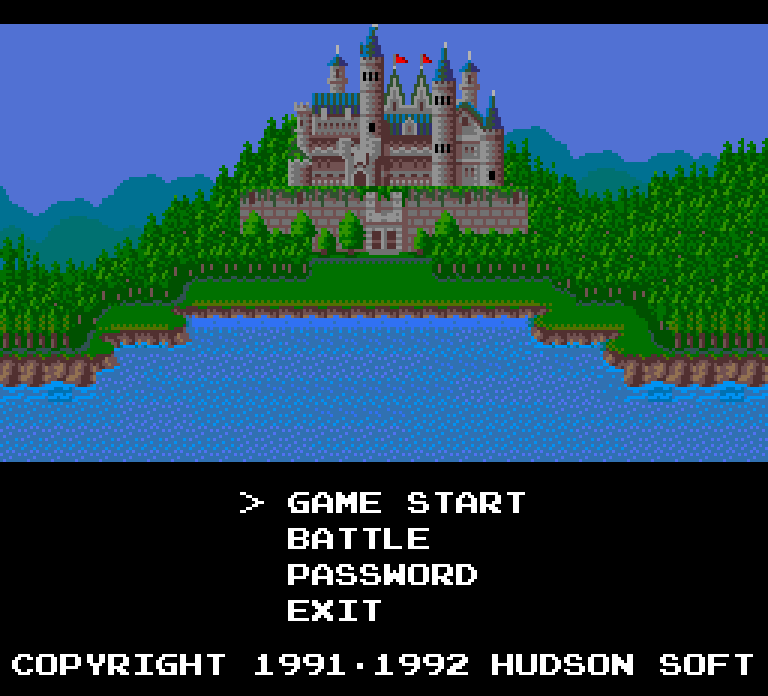
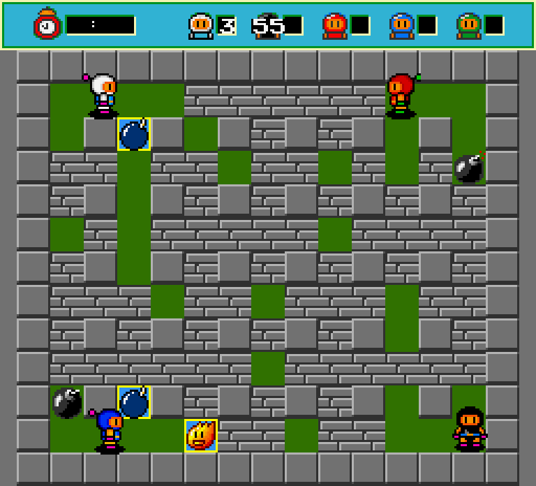
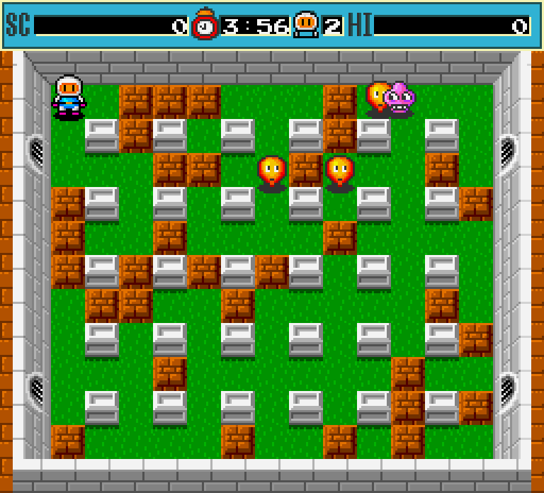
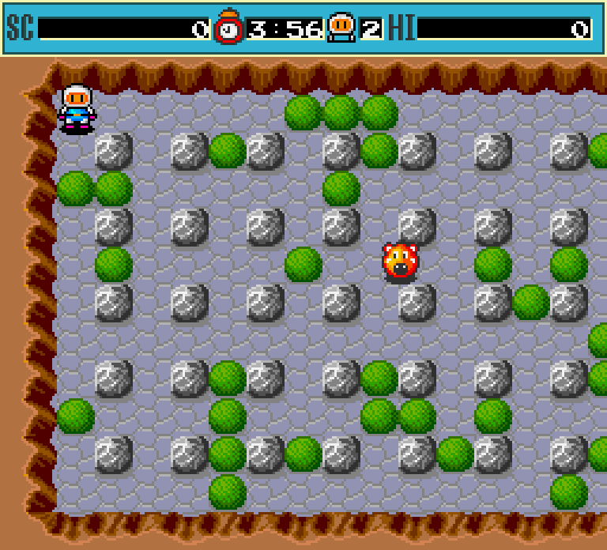
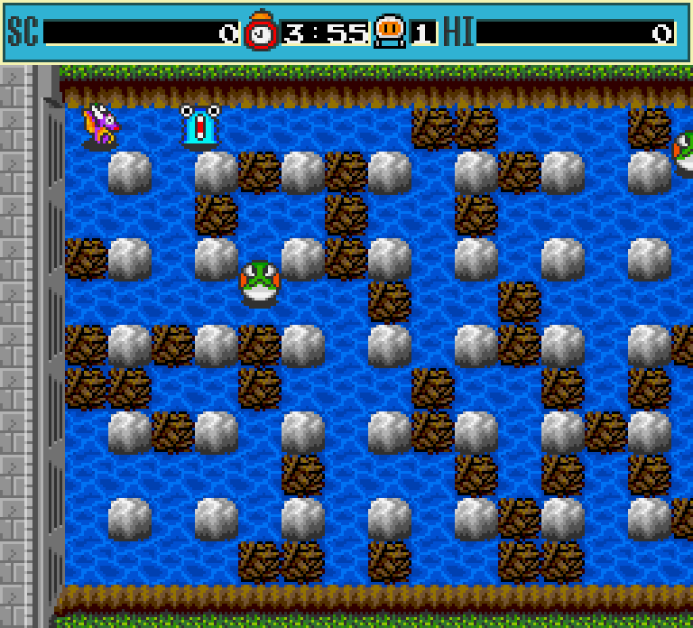

# 💣 Dyna Blaster for Mac

**Dyna Blaster** (aka *Bomberman*, Hudson Soft, 1992) running **natively on Apple Silicon Macs**. It's a just-for-fun, fan-made re-creation of the classic DOS game.

There is no emulator and no DOSBox. The game logic was reverse-engineered from the original `DYNA.EXE` and rewritten in C with [raylib](https://www.raylib.com). The port then reads the graphics, sounds, music and level data directly from *your own copy* of the original game files.

<p align="center">
  
  
</p>
<p align="center">
  
  
  
</p>

## ⬇️ Download

**[Download DynaBlaster.dmg](https://github.com/yasintanriverdi/dyna-blaster-mac/releases/latest/download/DynaBlaster.dmg)**. All versions are on the [Releases page](https://github.com/yasintanriverdi/dyna-blaster-mac/releases).

- Requires an **Apple Silicon Mac** (M1 or newer) and macOS 11 or later.
- Requires **your own copy of the original DOS game**: the folder with `DYNA.EXE`, `GFX/`, `DIGI.DAT`, `MUSIC.DAT`, `DEMO.DAT` and `DYNA.CFG`. The game files are copyrighted and are **not** included.

### Install
1. Open the DMG and drag **Dyna Blaster** into **Applications**.
2. The app isn't notarized, so the first time you need to **right-click it → Open → Open**. Or run:
   ```sh
   xattr -dr com.apple.quarantine "/Applications/Dyna Blaster.app"
   ```
3. On first launch, select your original Dyna Blaster folder. The app remembers it.

## 🎮 Controls

| | Player 1 | Player 2 | Players 3 & 4 |
|---|---|---|---|
| Move | Arrow keys | I J K L | Gamepad 1 / 2 |
| Drop bomb | Space | A | A button |
| Remote detonate | Left Ctrl | – | B button |

Key bindings are read from your `DYNA.CFG`, just like in the original game.

Other keys:
- `P`: pause
- `M`: music on/off
- `S`: sound effects on/off
- `Esc`: back to the menu
- `F11` or `⌘F`: fullscreen

Wait about 20 seconds on the title screen and the original attract-mode demo plays.

## ✨ What works

- **Battle mode** for 2–4 bombers, with the original win counts, skulls and diseases, round timers and battle-mode monsters.
- **Story mode** across all 8 worlds:
  - stages 1–7 of each world, with scrolling maps, 23 enemy types and the original AI
  - hidden power-ups, exit doors, score bonuses, lives and continues
  - the original **password system**, which takes the official level codes
- **Original graphics, sound effects and FM music.** The music is played through an OPL3 (AdLib) emulator.
- **Original timing.** Game logic runs at the DOS game's 18.2 Hz tick rate, while the screen draws at a smooth 60 FPS.

### Not yet
- Boss fights (stage 8 of each world). For now a boss stage has its regular enemies only, and an exit door appears once they're cleared.
- Some menu, intro and ending screens are simplified.

## 🛠 Build from source

```sh
brew install raylib
cd port
make                         # builds ./dynablaster (arm64)
./dynablaster /path/to/dyna  # folder with your original game files
make test                    # password codec self-test against DYNA.COD
make dmg                     # builds build/DynaBlaster.dmg (app bundle + installer image)
```

## 🔍 How it was made

The whole port is based on reverse engineering the original 16-bit DOS executable with the REA (Reverse Engineer Anything) toolset and Ghidra:

1. **Unpacking.** `DYNA.EXE` turned out to be compressed with LZEXE 0.91. [`tools/unlzexe.py`](tools/unlzexe.py) unpacks it so the real code can be analysed.
2. **Decompiling.** All 272 procedures were decompiled. The four detailed write-ups below cover movement, bombs, explosions, enemy AI, level data, passwords, graphics, sound and timing.
3. **Re-implementing.** The game was rewritten in C, function by function, following those notes. Every table is read from the original data segment at runtime: tiles, sprites, maps, enemies and the random-number generator.

| Document | Contents |
|---|---|
| [ARCHITECTURE.md](docs/re/ARCHITECTURE.md) | Overview of the original program and the port design |
| [players.md](docs/re/players.md) | Input, movement and corner sliding, death |
| [bombs.md](docs/re/bombs.md) | Map cells, RNG, bombs, explosions, power-ups, battle rules |
| [story_enemies.md](docs/re/story_enemies.md) | Story flow, all 64 stages, passwords, enemy AI, bosses |
| [engine.md](docs/re/engine.md) | File formats, sprites, Mode X screen, timing, audio, keyboard |

Repository layout:

```
port/        native macOS port (C + raylib) — see port/README.md
docs/re/     reverse-engineering notes
tools/       helper scripts (LZEXE unpacker, asset extractor, REA session driver)
```

## ⚖️ Legal

This is a non-commercial fan project made for fun and preservation. *Dyna Blaster* / *Bomberman* are trademarks of Hudson Soft / Konami. No original game code or assets are included in this repository or in the DMG; you need your own copy of the game.

The port's source code is under the [LICENSE](LICENSE) in this repository. [Nuked-OPL3](https://github.com/nukeykt/Nuked-OPL3) is LGPL-2.1.