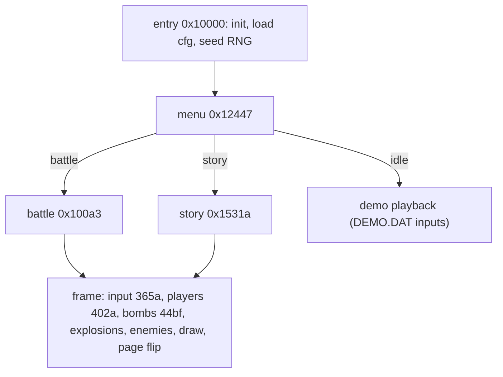

# Dyna Blaster (DOS) — Reconstructed Architecture

Detail docs: [players.md](file:///Users/yasin/Desktop/Projects/rea-test/docs/re/players.md) · [bombs.md](file:///Users/yasin/Desktop/Projects/rea-test/docs/re/bombs.md) · [story_enemies.md](file:///Users/yasin/Desktop/Projects/rea-test/docs/re/story_enemies.md) · [engine.md](file:///Users/yasin/Desktop/Projects/rea-test/docs/re/engine.md)

## Binary
- `DYNA.EXE`: 16-bit real-mode MZ program packed with LZEXE 0.91 → unpacked by [unlzexe.py](file:///Users/yasin/Desktop/Projects/rea-test/tools/unlzexe.py). Code segment 0x1000, data segment DS=0x1965. Analysed with REA (Ghidra 12.1.4, x86 16-bit real mode): 272 procedures, all decompiled.
- Hand-written assembly. Two Creative drivers are linked in: CT-VOICE (digital sound) and SBFMDRV (CMF music).

## Program flow

## Timing
- 1 logic tick = INT 1Ch = **18.2 Hz**; vsync page flip.
- Timer and animation step DS:1E is 4 per tick.

## World
- Tiles are 16×16. Battle map 15×13; story maps 15×13, 31×13 (horizontal scroll) or 15×29 (vertical scroll).
- Map: one byte per cell.

| Char | Meaning |
|---|---|
| `*` | hard wall |
| `.` | empty |
| `+` | bomb |
| `-` | exploding bomb centre |
| `A`..`U` | soft block; the letter is the item hidden under it |
| `V` | block crumbling |
| `a`..`t` | items on the floor |
| `u` | exit door |

## Players
- Pixel position x = col·16+16, y = row·16+32.
- Speed in 8.8 fixed point: battle 0x300 (3 px/tick), story 0x240 → 0x3C0.
- One direction per tick, priority U>D>L>R. Walls are checked only when centred on the movement axis; corner slide is 1 px.

## Bombs and explosions
- 8 shared bomb slots. Fuse is 53 ticks; a flame hitting a bomb shortens its fuse to 4 (chain).
- Arms stop at the first non-empty cell. Damage lasts 10 ticks; blocks crumble in 16–18 ticks.
- RNG: self-modifying 130-byte table at DS:38BB.

## Story mode
- 8 worlds × 8 stages from the table at DS:4FBC.
- Each stage record: scroll mode, number of blocks removed, hidden item, (count, type) list of enemies.
- 23 enemy types (speed 1–3, wall-pass, chase, …). Stage x.8 is a boss.
- 4:00 timer, passwords (all 64 decode correctly), 2 extra lives, 3 continues.

## Battle mode
- 2–4 players; 3:00–4:00 round timer; first to 1–5 round wins takes the match.
- Items: bomb-up, fire-up, skull (4 diseases).

## Rendering and audio (original)
- Mode X 256×232 with two pages. Transparent colour index 3. Sprite rect tables are in engine.md appendices.
- DIGI.DAT = 5 VOC sound effects. MUSIC.DAT = 15 CMF (OPL2) songs.

## Port plan (Phase 3)
- C11 + raylib, clang arm64, `Makefile`.
- Load the original IMG/DAT files at runtime: ILBM decode → palette-indexed → RGBA textures.
- Fixed 18.2 Hz logic tick with 60 FPS interpolated rendering; 256×232 virtual screen scaled up.
- Audio: VOC slices → raylib `Sound`. CMF → small OPL2 emulator (e.g. a bundled Nuked-OPL3, which is permissively licensed) streamed as `AudioStream`.
